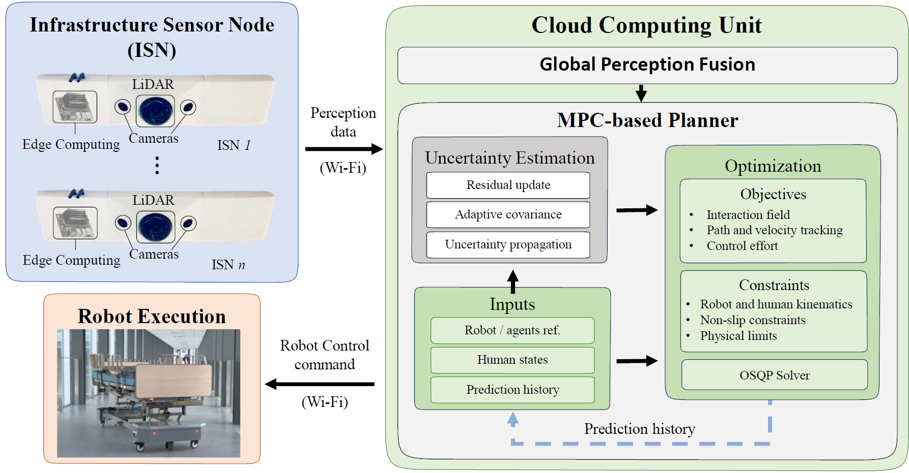
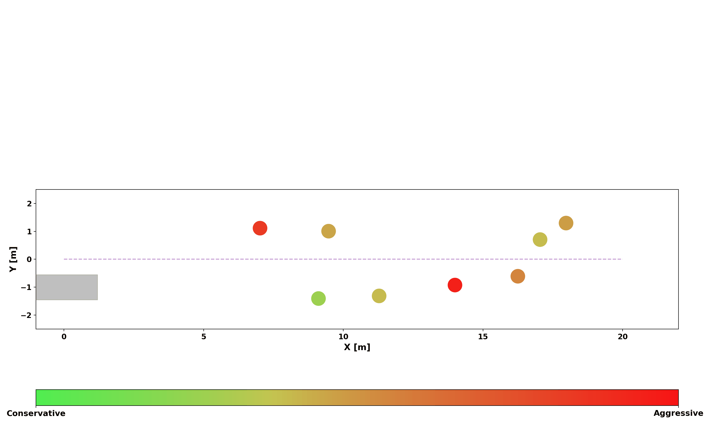
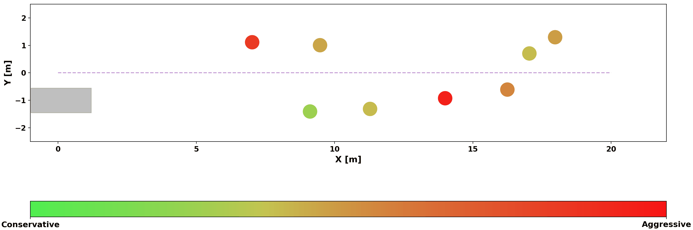
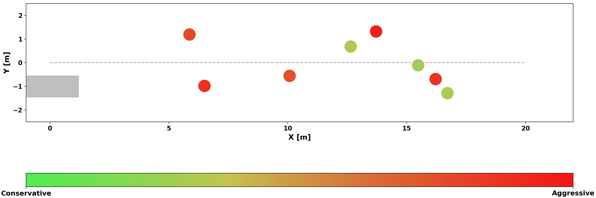
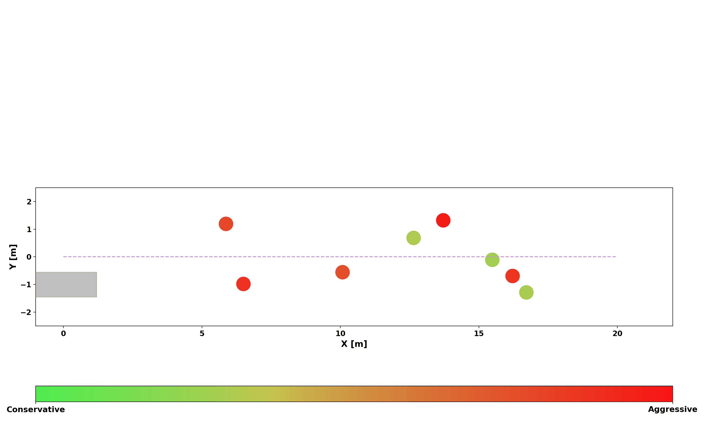
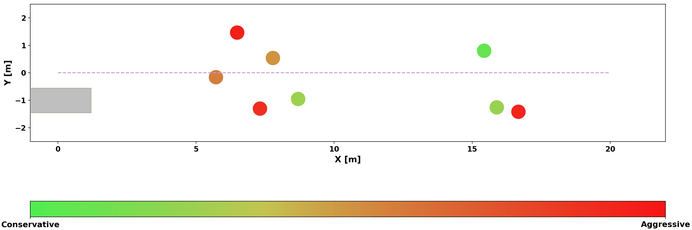
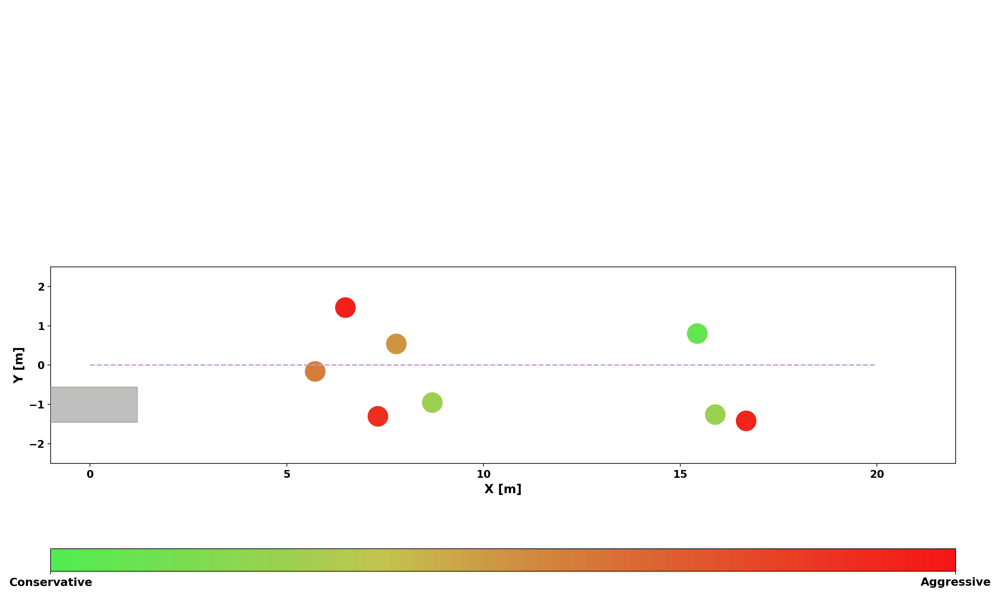

# UJIPPlanning Project

Official Repo of "Uncertainty-Aware Joint Interaction Prediction and Planning for Omnidirectional Mobile Robots"

Authored by Yufeng Yang, Minghao Ning, Keqi Shu, Jiaming Zhong*, Shucheng Huang, Ehsan Hashemi and Amir Khajepour.

* indicates equal contribution.

For questions, please get in touch with Yufeng Yang, f248yang@uwaterloo.ca.

## Overall Structure

  

## Social-aware Motion Planning Simulation Results

**Simulations:** [#10](#simulation-10) · [#38](#simulation-38) · [#89](#simulation-89)

Select an animation to view it at full resolution.

---

## Simulation #10

**Proposed (Ours)**

**Conventional**

**SARL**

---

## Simulation #38

**Proposed (Ours)**

**Conventional**

**SARL**

---

## Simulation #89

**Proposed (Ours)**

**Conventional**

**SARL**

## Overall Experiments Video

<table>
  <tr>
    <td align="center">
       
      <b><a href="https://youtu.be/Sn0WQt7h8WU">Experiment Video 1</a></b>
    </td>
    <td align="center">
       
      <b><a href="https://youtu.be/6DhArDZANUo">Experiment Video 2</a></b>
    </td>
  </tr>
</table>
